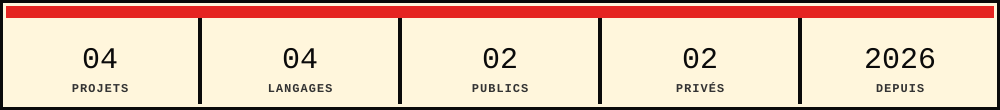

  

  
  
  

  

### <samp>&gt; projets --afficher</samp>

| Projet | Description | Stack | Accès |
|:--|:--|:--|:--|
| **[Eventis](https://github.com/arthurdevcod02/eventis)** | Plateforme événementielle reliant clients et prestataires au Togo. | JavaScript |  |
| **[Free Spirit](https://github.com/arthurdevcod02/free-spirit)** | Boutique streetwear immersive. | HTML - CSS - JS - Bootstrap |  |
| **AhoePay** | Gestion des loyers, avances et charges d'une concession au Togo. | Flutter - Dart |  |
| **Nova Lab** | Site vitrine d'un studio digital et gaming. | HTML - CSS |  |

### <samp>&gt; stack --equipement</samp>

| Équipement | Contenu |
|:--|:--|
| **Langages** |    |
| **Interface** |    |
| **Mobile** |  |
| **Outils** |    |

### <samp>&gt; profil --stats</samp>

  

 

> « Un bon développeur ne joue pas au jeu. Il réécrit les règles. »

  

 

  

<samp>Merci d'être passé. <a href="https://arthurdevcod02.github.io/parcours/">Le prochain niveau vous attend.</a></samp>

